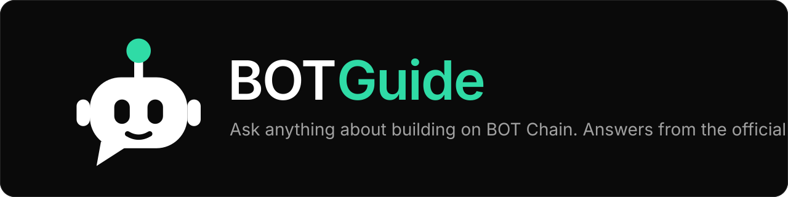

<p align="center"></p>

# BOTGuide

**An AI guide for developers building on BOT Chain. Answers come from the official docs, with sources.**

Ask a question about BOT Chain (networks, faucet, deploying, tools, common errors) and get a short answer with the doc sections it used. Rate answers 👍/👎 and share tips on BOT Chain. Tips the owner approves become part of what the AI can use. BOTGuide is a community project and is **not** official BOT Chain documentation.

[Live App](#deploy) | [Contract](#contract) | [How it works](#how-it-works) | [Screens](#screens) | [Run it locally](#run-it-locally) | [Limits](#limits-said-plainly)

## How it works

1. A knowledge base is built from the official developer docs (`dev-docs.botchain.ai`, 56 pages), a few site pages and community notes. It is saved as `public/kb.json` (about 280 chunks).
2. Your question is searched in your browser with MiniSearch. The best chunks (up to 5) are picked there.
3. The question and those chunks go to our API route `/guide`, which asks Groq (`openai/gpt-oss-120b`) and streams the answer back. The model must cite the sources it used. If the docs do not cover a BOT Chain question, it says so instead of guessing, and offers "Add a tip".
4. Chat history is saved only in your browser (localStorage). There is no database and no account.
5. 👍/👎 votes and tips are transactions on the BOTGuide contract. Only a hash of the answer goes on-chain, never the chat.
6. A tip stays **Pending review** until the owner approves it. Only approved tips are added to the search index, labeled "Community tip". Pending tips never reach the AI.

## Screens

| Route | What it is |
| --- | --- |
| `/` | Landing page: hero, how it works, developers, ecosystem links, community tips, FAQ |
| `/ask` | The chat: sources, follow-up questions, network facts panel, local history |
| `/ask?q=...` | Share link that asks a question |
| `/ask?tip=ID` | Opens the Community tips panel on that tip (unknown id shows "Tip not found") |
| `/guide` | API route that talks to Groq (not a page) |

## Contract

`contracts/contracts/BOTGuide.sol` (Solidity 0.8.20, EVM `paris`, no tokens, no payments).

- `rate(answerId, helpful)`: one vote per wallet per answer. `answerId` is `keccak256` of the normalised question and answer text.
- `submitTip(title, body, section)`: limits are 80 / 500 / 32 bytes. New tips are pending.
- `upvoteTip(id)`: once per wallet, not on your own tip.
- `approveTip(id)`: owner only.
- Views for the app: `getVote`, `getTips`, `getApprovedTips`, `tipCount`, `stats`.

| Network | Chain ID | Address |
| --- | --- | --- |
| BOT Chain Testnet | 968 | not deployed yet |
| BOT Chain Mainnet | 677 | not deployed yet |

Until an address is set in `lib/config.ts`, rating and tips show a clear "not deployed yet" message and nothing is faked. 13 contract tests pass (`cd contracts && npx hardhat test`).

## Project layout

```
BOTGuide/
  app/          Next.js routes: / (landing), /ask (chat), /guide (Groq proxy)
  components/   landing/ and chat/ UI
  lib/          search, answer streaming, prompt and parser, contract and wallet helpers, config
  docs/         official/ (synced docs), site/, lessons/ (community notes), design-spec.md
  public/       kb.json (the knowledge base) and brand assets
  contracts/    Hardhat project: BOTGuide.sol, tests, deploy and approve-tip scripts
  scripts/      check-kb.mjs (search checks), ask.mjs (end-to-end test)
  sync-docs.js  downloads the official docs
  build-kb.js   builds public/kb.json and lib/kb-meta.json
```

## Run it locally

```bash
npm install
cp .env.example .env            # put your GROQ_API_KEY in it
npm run dev                     # http://localhost:3000
```

Refresh the knowledge base before a release:

```bash
npm run sync-docs               # download the official docs
npm run build-kb                # rebuild public/kb.json
npm run check-kb                # sanity-check search
```

Test the contract flow without spending BOT:

```bash
cd contracts && npm install
npx hardhat node                                    # terminal 1
npx hardhat run scripts/deploy.js --network localhost   # terminal 2, prints the address
# in the app's .env.local:
#   NEXT_PUBLIC_BOTGUIDE_NETWORK=local
#   NEXT_PUBLIC_BOTGUIDE_ADDRESS=0x...
```

Approve a tip as the owner: `CONTRACT=0x... TIP_ID=0 npx hardhat run scripts/approve-tip.js --network localhost` (add `LIST=1` to list tips first).

Secrets live only in `.env`, `.env.local` and `contracts/.env`. All are git-ignored.

## Deploy

- **App (Vercel):** import the repo and add `GROQ_API_KEY` (secret). `GROQ_MODEL` is optional.
- **Contract (testnet first):** put `PRIVATE_KEY=0x...` of a test wallet in `contracts/.env`, claim tBOT from the [faucet](https://faucet.botchain.ai/basic) (10 tBOT per address per 24 hours), then run `npx hardhat run scripts/deploy.js --network botTestnet`. After that, repeat with `botMainnet`.
- Put the printed address in `lib/config.ts` (`TESTNET_CONTRACT_ADDRESS` or `MAINNET_CONTRACT_ADDRESS`) and set `BOTGUIDE_NETWORK` to the network you use.

## Limits, said plainly

- Answers can be wrong or out of date. Check important values (chain IDs, RPC URLs, addresses) in the official docs. The app shows a network facts panel for this.
- Votes are not identity-checked: one wallet is one vote, but anyone can use many wallets.
- The rate limit (30 questions per IP per hour) is an in-memory counter. Fine for a demo; move it to Redis or Upstash on serverless.
- Community tips are written by users. The owner reviews them, but they may still be outdated, and the official docs always win.

## Siapa yang menggunakan BOTGuide?

- **Developer baru di BOT Chain:** bertanya cara menambah jaringan, klaim faucet, deploy kontrak, atau memperbaiki error umum, dan mendapat jawaban dengan sumber docs.
- **Peserta hackathon dan komunitas:** berbagi tip dari pengalaman nyata, lalu pemilik menyetujui tip yang layak agar masuk ke basis pengetahuan.
- **Pemilik proyek:** melihat jawaban mana yang dinilai berguna lewat rating on-chain.

## Catatan penting

- Hanya hash jawaban (untuk rating) dan teks tip yang masuk on-chain. Isi percakapan tidak pernah disimpan di server atau di blockchain.
- Tip yang belum disetujui tidak pernah dikirim ke AI.
