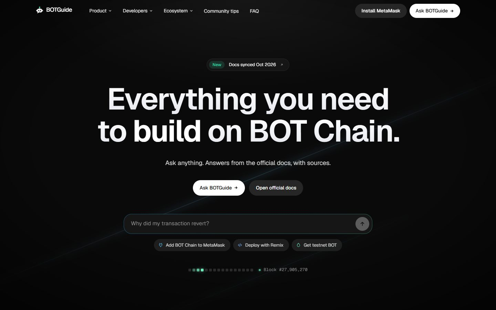
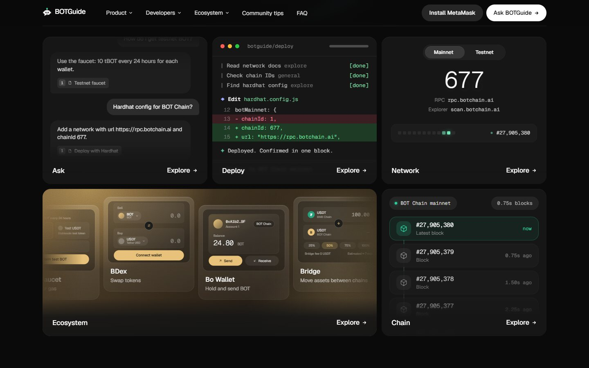
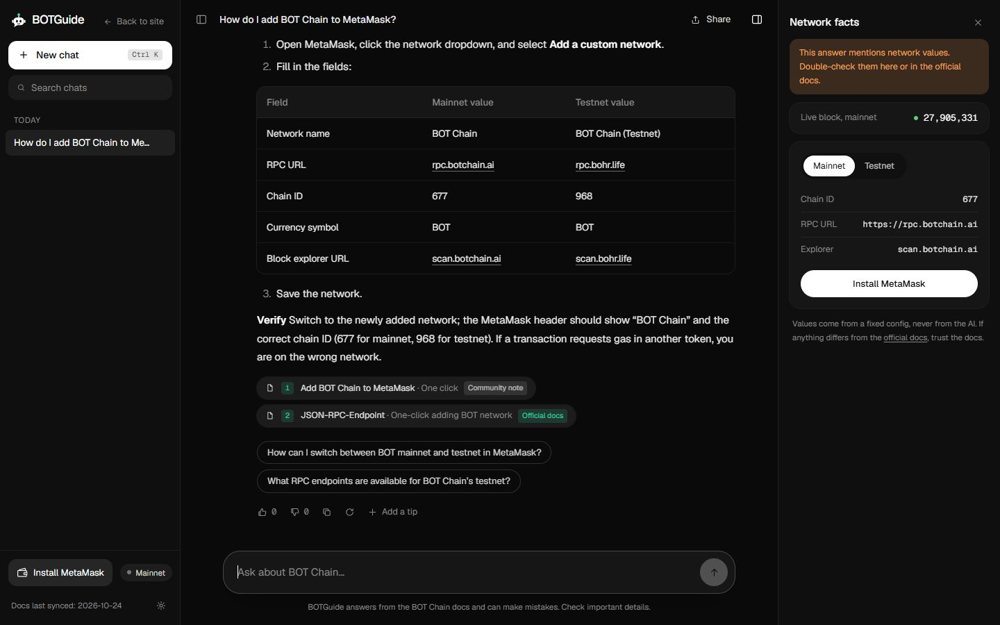
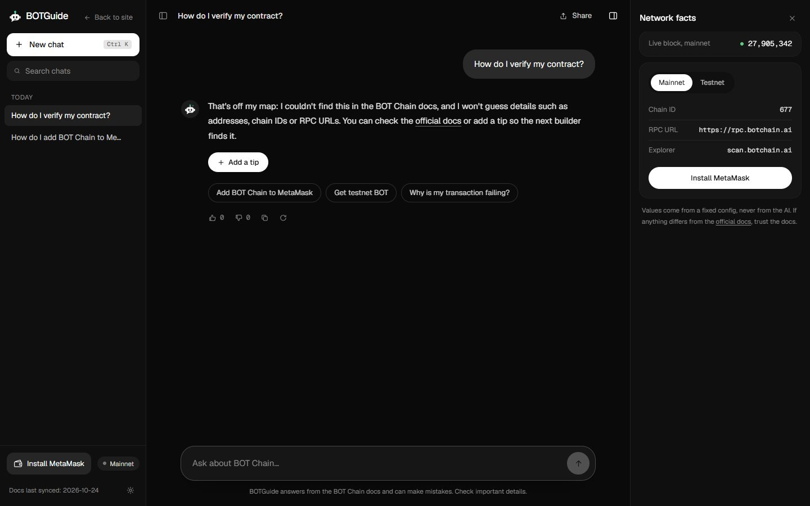
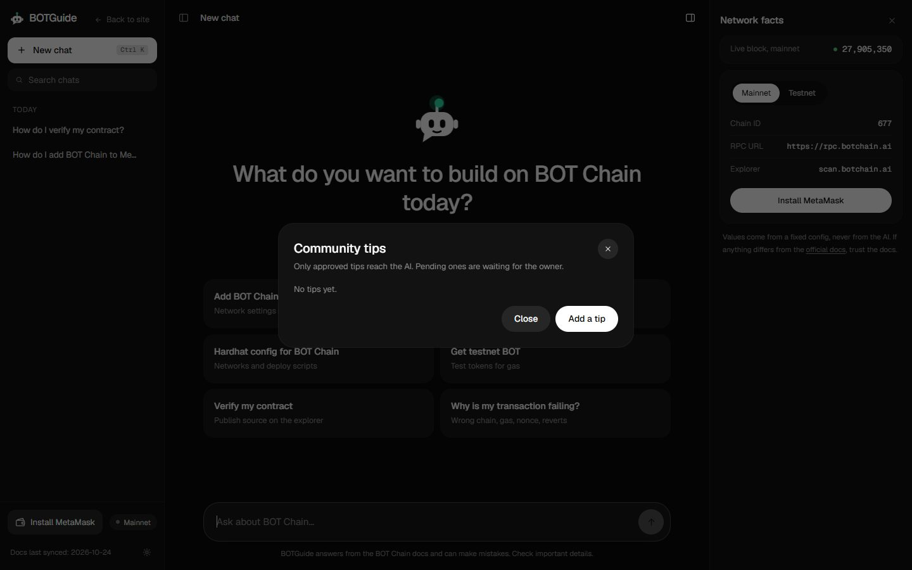
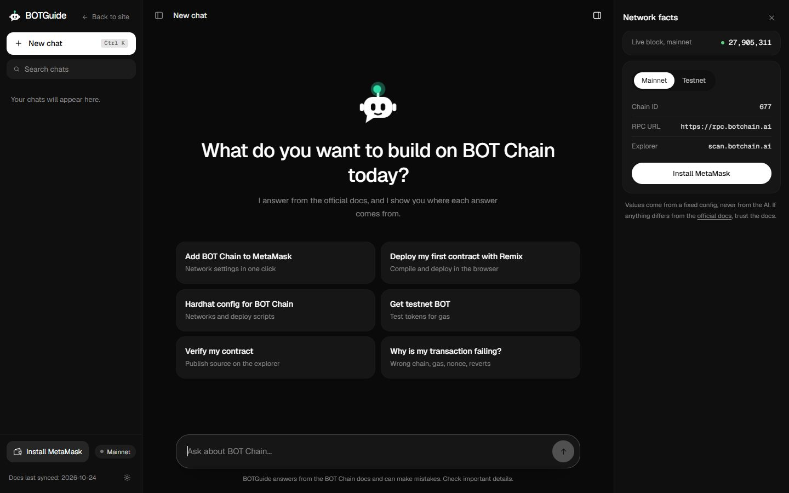
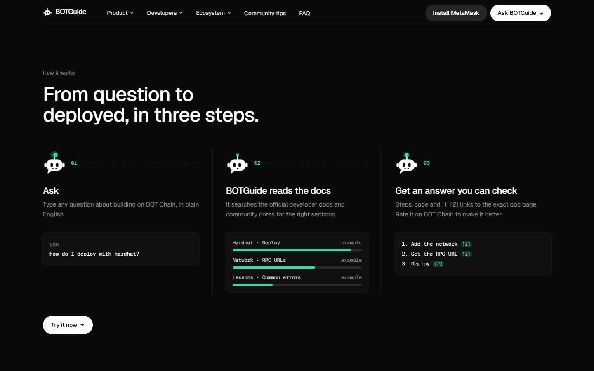
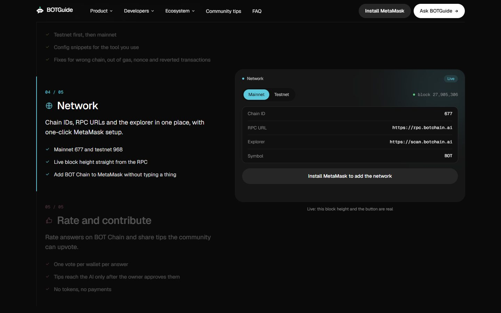
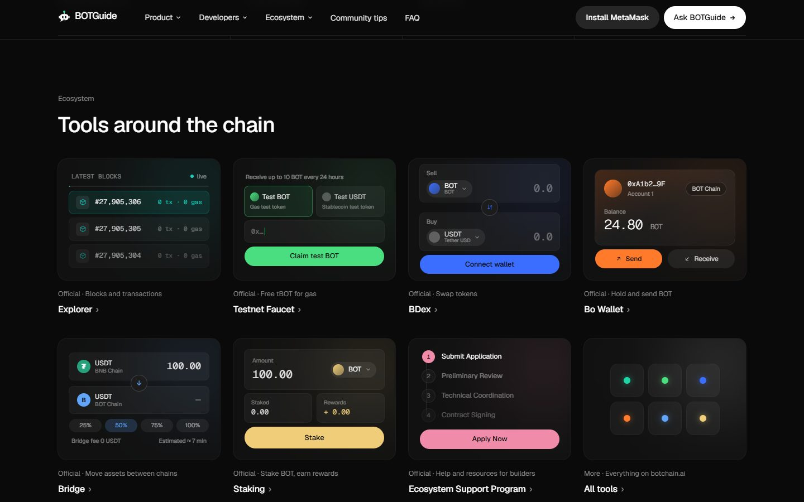

<div align="center">


# BOTGuide

**An AI guide for developers building on BOT Chain. Answers come from the official docs, with sources.**

Ask a question about BOT Chain (networks, faucet, deploying, tools, common errors) and get a short answer with the doc sections it used. Rate answers 👍/👎 and share tips on BOT Chain. Tips the owner approves become part of what the AI can use. Your chats never leave your browser except to be answered, and they are never on-chain. BOTGuide is a community project and is **not** official BOT Chain documentation.

[Contract (mainnet)](https://scan.botchain.ai/address/0xe6c8AF7ad92093b1a329F622789647227c66dd63) | [How it works](#how-it-works) | [Screens](#screenshots) | [Run it locally](#run-it-locally) | [Deploy](#deploy) | [Limits](#limits-said-plainly)






</div>

## Screenshots

<table>
<tr>
<th width="50%">Ask</th>
<th width="50%">When the docs do not cover it</th>
</tr>
<tr>
<td></td>
<td></td>
</tr>
<tr>
<td>Short answer first, steps and tables, numbered sources under it, and a facts panel with the network values from a fixed config.</td>
<td>If the docs have nothing, it says so instead of guessing, and offers "Add a tip" so the next builder finds it.</td>
</tr>
<tr>
<th>Community tips</th>
<th>Start a chat</th>
</tr>
<tr>
<td></td>
<td></td>
</tr>
<tr>
<td>Tips are transactions on the contract. Only tips the owner approved are labeled "Approved" and reach the AI.</td>
<td>Starter questions, local chat history, search, and a Ctrl K shortcut for a new chat.</td>
</tr>
</table>

<table>
<tr>
<th>Landing: how it works</th>
</tr>
<tr>
<td></td>
</tr>
<tr>
<td>Three steps: ask, BOTGuide reads the docs, and you get an answer you can check.</td>
</tr>
<tr>
<th>Landing: live network panel</th>
</tr>
<tr>
<td></td>
</tr>
<tr>
<td>Chain IDs and RPC URLs come from a fixed config. The block height is read live from the RPC.</td>
</tr>
<tr>
<th>Landing: ecosystem</th>
</tr>
<tr>
<td></td>
</tr>
<tr>
<td>Explorer, faucet, BDex, Bo Wallet, Bridge, Staking and the Ecosystem Support Program, each linking to the official site.</td>
</tr>
</table>

## How it works

1. A knowledge base is built from the official developer docs (`dev-docs.botchain.ai`), a few site pages and community notes: 65 pages, about 280 chunks. It is saved as `public/kb.json`.
2. Your question is searched in your browser with MiniSearch. The best chunks (up to 5) are picked there. Common Indonesian words are mapped to the docs' English terms first, so questions in Indonesian find the same sections.
3. The question and those chunks go to our API route `/guide`, which asks Groq (`openai/gpt-oss-120b`) and streams the answer back. The model must cite the sources it used. If the docs do not cover a BOT Chain question, it says so instead of guessing, and offers "Add a tip". Any URL in an answer that is not in the sources or the fixed config is replaced.
4. Chat history is saved only in your browser (localStorage). There is no database and no account.
5. 👍/👎 votes and tips are transactions on the BOTGuide contract. Only a hash of the answer goes on-chain, never the chat.
6. A tip stays **Pending review** until the owner approves it. Only approved tips are added to the search index, labeled "Community tip". Pending tips never reach the AI.

**Only the answer hash (for ratings) and the text of a tip are on-chain. Chats never are.**

## Screens

| Route | What it is |
| --- | --- |
| `/` | Landing page: hero, how it works, product, developers, ecosystem, community tips, FAQ |
| `/ask` | The chat: sources, follow-up questions, network facts panel, local history |
| `/ask?q=...` | Share link that asks a question |
| `/ask?tip=ID` | Opens the Community tips panel on that tip (unknown id shows "Tip not found") |
| `/ask?tip=all` | Opens the Community tips panel without pointing at one tip |
| `/guide` | API route that talks to Groq (not a page) |

## Contract

`contracts/contracts/BOTGuide.sol` (Solidity 0.8.20, EVM `paris`, no tokens, no payments).

- `rate(answerId, helpful)`: one vote per wallet per answer. `answerId` is `keccak256` of the normalised question and answer text.
- `submitTip(title, body, section)`: limits are 80 / 500 / 32 bytes. New tips are pending.
- `upvoteTip(id)`: once per wallet, not on your own tip.
- `approveTip(id)`: owner only.
- Views for the app: `getVote`, `getTips`, `getApprovedTips`, `tipCount`, `stats`.

| Network | Chain ID | Address |
| --- | --- | --- |
| BOT Chain Testnet | 968 | `0x015eDcdd020D0834F69048a467A5b40bf8D16aB9` ([scan.bohr.life](https://scan.bohr.life/address/0x015eDcdd020D0834F69048a467A5b40bf8D16aB9)) |
| BOT Chain Mainnet | 677 | `0xe6c8AF7ad92093b1a329F622789647227c66dd63` ([scan.botchain.ai](https://scan.botchain.ai/address/0xe6c8AF7ad92093b1a329F622789647227c66dd63)) |

The app points at the mainnet contract. It was deployed with the owner's own wallet, and its 18 functions and all events match `BOTGuide.sol` (checked against the deployed bytecode). The testnet contract stays up for testing. If no address is set in `lib/config.ts`, rating and tips show a clear "not deployed yet" message and nothing is faked. 13 contract tests pass (`cd contracts && npx hardhat test`).

## Project layout

```
BOTGuide/
  app/          Next.js routes: / (landing), /ask (chat), /guide (Groq proxy)
  components/   landing/ and chat/ UI, the Bo mascot, the shared wallet menu
  lib/          search, answer streaming, prompt and parser, contract and wallet helpers, config
  docs/         official/ (synced docs), site/, lessons/ (community notes), shots/ (README images), design-spec.md
  public/       kb.json (the knowledge base) and brand assets
  contracts/    Hardhat project: BOTGuide.sol, tests, deploy and approve-tip scripts
  scripts/      check-kb.mjs (search checks), ask.mjs (end-to-end test), tip-check.mjs
  sync-docs.js  downloads the official docs
  build-kb.js   builds public/kb.json and lib/kb-meta.json
```

## Run it locally

```bash
git clone https://github.com/Devs-GMT/BOTGuide.git
cd BOTGuide
npm install
cp .env.example .env            # put your GROQ_API_KEY in it
npm run dev                     # http://localhost:3000
```

Refresh the knowledge base before a release:

```bash
npm run sync-docs               # download the official docs
npm run build-kb                # rebuild public/kb.json
npm run check-kb                # sanity-check search
node scripts/tip-check.mjs      # check that an approved tip is found
```

Test the contract flow without spending BOT:

```bash
cd contracts && npm install
npx hardhat node                                    # terminal 1
npx hardhat run scripts/deploy.js --network localhost   # terminal 2, prints the address
# in the app's .env.local:
#   NEXT_PUBLIC_BOTGUIDE_NETWORK=local
#   NEXT_PUBLIC_BOTGUIDE_ADDRESS=0x...
```

Approve a tip as the owner: `CONTRACT=0x... TIP_ID=0 npx hardhat run scripts/approve-tip.js --network localhost` (add `LIST=1` to list tips first).

Secrets live only in `.env`, `.env.local` and `contracts/.env`. All are git-ignored.

## Deploy

- **App (Vercel):** import the repo and add `GROQ_API_KEY` (secret). `GROQ_MODEL` and `GROQ_REASONING` are optional. For a rate limit shared across instances, also set `UPSTASH_REDIS_REST_URL` and `UPSTASH_REDIS_REST_TOKEN` (free Upstash Redis); without them the limit is in memory.
- **Contract (testnet first):** put `PRIVATE_KEY=0x...` of a test wallet in `contracts/.env`, claim tBOT from the [faucet](https://faucet.botchain.ai/basic) (10 tBOT per address per 24 hours), then run `npx hardhat run scripts/deploy.js --network botTestnet`.
- Put the printed address in `lib/config.ts` (`TESTNET_CONTRACT_ADDRESS` or `MAINNET_CONTRACT_ADDRESS`) and set `BOTGUIDE_NETWORK` to the network you use.

## Mainnet

The contract is live on BOT Chain mainnet (chain ID 677) at [`0xe6c8AF7ad92093b1a329F622789647227c66dd63`](https://scan.botchain.ai/address/0xe6c8AF7ad92093b1a329F622789647227c66dd63). The owner (the wallet that deployed it) is the only one who can approve tips. To redeploy or deploy your own copy:

1. Put the owner's `PRIVATE_KEY` in `contracts/.env` and make sure the wallet has BOT for gas. Or open `contracts/contracts/BOTGuide.sol` in Remix: compiler `0.8.20`, optimizer on (200 runs), no constructor arguments, mainnet wallet on chain ID 677.
2. With Hardhat: `npx hardhat run scripts/deploy.js --network botMainnet`.
3. Put the address in `MAINNET_CONTRACT_ADDRESS` in `lib/config.ts`, set `BOTGUIDE_NETWORK = "mainnet"`, and redeploy the app.
4. Optional: `CONTRACT=0x... npx hardhat run scripts/seed-tips.js --network botMainnet` adds and approves a few starter tips (owner only; edit the list first).

## Limits, said plainly

- Answers can be wrong or out of date. Check important values (chain IDs, RPC URLs, addresses) in the official docs. The app shows a network facts panel for this.
- The official docs have no guide for Remix, Hardhat, Foundry or contract verification. Answers about them come from short community notes, are labeled "Community note", and may be outdated. If nothing covers a BOT Chain question, BOTGuide says it could not find it.
- Votes are not identity-checked: one wallet is one vote, but anyone can use many wallets.
- The rate limit is 30 questions per IP per hour. It is shared across instances when the Upstash variables are set, and an in-memory counter (per instance) otherwise. The Upstash path is not tested yet.
- Community tips are written by users. The owner reviews them, but they may still be outdated, and the official docs always win.

## Who is BOTGuide for?

### Main users

1. **New BOT Chain developers** (main users): ask how to add the network, claim the faucet, deploy a contract or fix a common error, and get an answer with doc sources. Benefit: no need to read the whole documentation to answer one question.
2. **Hackathon participants and the community** (contributors): share tips from real experience, and the owner approves the ones worth keeping so they join the knowledge base. Benefit: community knowledge helps answer the next question.
3. **Project owners and the BOT Chain team** (reviewers): see which answers people found useful through on-chain ratings, and review tips before they are approved. Benefit: learn which parts of the documentation are still confusing.

### Additional target users

4. **Blockchain teachers and mentors**: point students to the official sources with citations they can check.
5. **EVM developers coming from other chains**: check what is different on BOT Chain (chain ID, RPC, faucet) before moving a project.

## Roadmap

| Version | Features |
| --- | --- |
| **MVP (V1)** | Q&A from the official docs with citations, on-chain ratings and tips, owner approval of tips, live on mainnet |
| V1.1 | Deploy the contract to mainnet 677 with the owner's wallet, then switch the app to mainnet |
| V1.2 | Replace the draft community notes with real ones, then re-sync the docs |
| V2 | Not decided yet. Ideas: semantic search, more languages |

Only the MVP (V1) is built today. The other versions are plans.

## Important notes

- Only the answer hash (for ratings) and the text of a tip go on-chain. The content of a chat is never stored on a server or on the blockchain.
- A tip that has not been approved is never sent to the AI.
- BOTGuide is a community project, not official BOT Chain documentation. If an answer disagrees with the official docs, the official docs are right.
